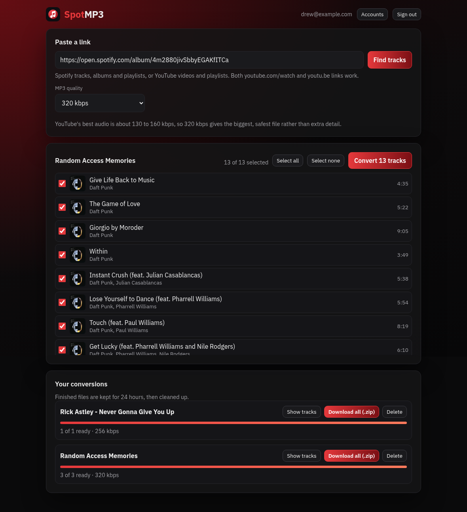

<div align="center">

# SpotMP3

**A self-hosted web app that turns Spotify and YouTube links into tagged MP3s. Paste a track, album or playlist, pick a quality, and download the files one by one or as a zip, with titles, artists, album and cover art filled in.**

[](https://www.python.org/)
[](https://flask.palletsprojects.com/)
[](https://github.com/yt-dlp/yt-dlp)
[](LICENSE)

</div>



---

## Overview

Paste a link, tick the tracks you want and press Convert. For Spotify links,
SpotMP3 reads the track list (no Spotify account or API key needed), finds
the matching song on YouTube Music or YouTube, downloads the audio and
converts it to MP3 with ffmpeg. YouTube links skip the matching step and
convert the video's audio directly.

Conversions run one at a time in the background, survive restarts, and
finished files are cleaned up after a set number of hours so the disk never
fills up.

## Links it understands

| Link | Example |
|---|---|
| Spotify track | `https://open.spotify.com/track/...` (with or without `?si=...`) |
| Spotify album | `https://open.spotify.com/album/...` |
| Spotify playlist | `https://open.spotify.com/playlist/...` or `spotify:playlist:...` |
| YouTube video | `https://www.youtube.com/watch?v=...` and `https://youtu.be/...` (also Shorts, YouTube Music and links with `&list=` or `?si=` on the end) |
| YouTube playlist | `https://www.youtube.com/playlist?list=...` |

Spotify only shares the first 100 tracks of a playlist link with apps that
are not signed in. Connect Spotify (below) to get every track, and to pick
from your own playlists and Liked Songs.

## How matching works

```
Spotify track (title, artists, length)
        |
YouTube Music "songs" search  ->  accept the first result whose title fits
        |                         and whose length is within a few seconds
        |  (nothing fits)
YouTube search, top 8 results  ->  score each on title, length, artist,
        |                          official / Topic channel
        |
Live, cover, remix, sped up, slowed, karaoke... are refused
unless the Spotify title asks for them
        |
No result good enough  ->  the track is marked Failed with the reason
```

## Quality

| Choice | What you get |
|---|---|
| 128 / 192 / 256 / 320 kbps | Constant bitrate MP3 |
| VBR V0 | Variable bitrate, about 245 kbps |

YouTube's best audio stream is roughly 130 to 160 kbps, so 320 kbps gives the
biggest and safest file, not extra detail. Every MP3 gets ID3v2.3 tags
(title, artist, album, track number) and a square cover image.

## Requirements

- Python 3.11+
- [`ffmpeg`](https://ffmpeg.org/) on your `PATH`

## Setup

```bash
python -m venv .venv
source .venv/bin/activate
pip install -r requirements.txt
cp .env.example .env
python -m spotmp3
```

Then open `http://127.0.0.1:8095`. The first visit shows a **setup page**
where you create the first account. That account is the admin and can add
or remove accounts for other people from the **Accounts** button.

## Configuration (`.env`)

| Key | Description |
|---|---|
| `BIND_HOST` / `PORT` | Where the web app listens. Default `127.0.0.1:8095`. |
| `DATA_DIR` | Database, finished files and temporary work. Default `./data`. |
| `PUBLIC_URL` | The address people use, e.g. `https://mp3.example.com`. Needed for Spotify connect. |
| `SECURE_COOKIES` | Set `true` when served over HTTPS. |
| `SPOTIFY_CLIENT_ID` | Optional, turns on Connect Spotify (see below). |
| `RETENTION_HOURS` | How long finished files are kept. Default `24`. |
| `STORAGE_LIMIT_MB` | Oldest files are cleaned up past this. Default `2048`. |
| `MIN_FREE_MB` | Conversions pause when the disk has less free space than this. Default `500`. |
| `MAX_TRACKS_PER_JOB` / `MAX_OPEN_JOBS_PER_USER` | Limits per conversion and per person. Defaults `500` and `5`. |
| `AUTH_MODE` | `builtin` (accounts in SpotMP3, the default) or `starfire` to trust an existing [starfire.ai](https://github.com/drew-codes-things/starfire.ai) sign-in via `STARFIRE_ME_URL`. |

## Connect Spotify (optional)

1. Create an app at the [Spotify developer dashboard](https://developer.spotify.com/dashboard).
2. Add the redirect URI `<PUBLIC_URL>/spotify/callback`, for example
   `https://mp3.example.com/spotify/callback`.
3. Put the app's Client ID in `SPOTIFY_CLIENT_ID` and restart.
4. While the Spotify app is in Development Mode, add each person's Spotify
   account under **User Management** in the dashboard.

Spotify sign-in happens in the browser with PKCE: no client secret is stored
and the Spotify token never reaches the server.

## Command line

```bash
python -m spotmp3 show "https://open.spotify.com/album/..."
python -m spotmp3 convert "https://youtu.be/..." --quality 256 --out ~/Music
```

`show` lists the tracks behind a link, `convert` makes the MP3s without the
web app.

## Keeping YouTube working

YouTube changes every few weeks and old copies of yt-dlp start failing. Update
it regularly (a weekly timer works well) and restart SpotMP3:

```bash
pip install -U "yt-dlp[default]"
```

## Tech

- Flask served by waitress, SQLite for accounts, sessions and jobs, one
  background worker thread converting a track at a time.
- yt-dlp for YouTube, ffmpeg (libmp3lame) for encoding, Spotify's public
  embed pages for track lists.
- Plain HTML, CSS and JavaScript: no build step.
- Passwords hashed with scrypt, 5 failed sign-ins lock that address and
  email for 15 minutes, every change needs a custom header (CSRF) and pages
  ship a strict Content Security Policy.

## Tests

```bash
pip install -r requirements-dev.txt
python -m pytest
```

Only download music you have the right to.

## License

MIT - made by Drew
